# motion-planning-practice

Песочница для практики планирования движения мобильного робота. **TurtleBot3 Burger**
ездит по складу в физическом симуляторе **MuJoCo**: стеллажи, узкий коридор, тупик,
несколько стартов и целей, и коробки, которые падают с полок прямо на маршрут.

Внутри можно сравнивать связки планировщиков и датчиков:

| Глобальные (путь по карте) | Локальные (управление) | Датчики |
|---|---|---|
| **A\*** (по умолчанию), Dijkstra | **DWA** (как DWB в Nav2) | **лидар** LDS-01, 360° |
| **RRT-Connect** | **MPPI** (контроллер Nav2 по умолчанию) | **RGB-D камера** RealSense D435 вместо лидара |
| **BIT\*** (Batch Informed Trees) | **log-MPPI** (MPPI с логнормальным шумом) | |
| **AIT\*** (Adaptively Informed Trees) | **RPP** (Regulated Pure Pursuit, Nav2) | |
| `ompl:<Planner>`: оригиналы из OMPL | **Graceful Controller** (новейший в Nav2) | |
| | **Vector Pursuit** (плагин сообщества Nav2) | |

Планировщики написаны на Python, чтобы их было удобно читать и менять, и
[проверены против эталонов](#насколько-это-правильно): A\* — против SciPy,
сэмплирующие — против OMPL, контроллеры перенесены по исходникам Nav2.

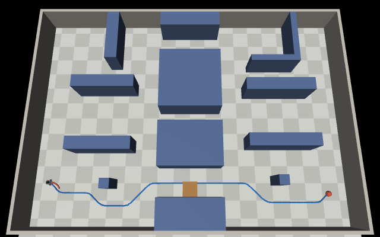


## Установка

```bash
# один раз: менеджер окружений uv (https://docs.astral.sh/uv/)
curl -LsSf https://astral.sh/uv/install.sh | sh

git clone https://github.com/byoverr/motion-planning-practice.git
cd motion-planning-practice
uv sync                 # Python 3.12 и зависимости в .venv
uv sync --extra ompl    # по желанию: эталонные планировщики OMPL
uv run pytest -q        # тесты (около 15 с)
```

## Быстрый старт

```bash
uv run mpp list                                    # сценарии, планировщики, старты и цели
uv run mpp map                                     # картинка карты -> results/map.png

# один заезд без окна: лог событий, метрики и картинка results/run_*/episode.png
uv run mpp run -s bypass -g astar -l dwa

# то же в окне MuJoCo (на macOS именно mjpython, на Linux можно просто python)
uv run mjpython -m mpp run -s blocked -g bit_star -l mppi --viewer --speed 2

# робот с RGB-D камерой вместо лидара; GIF с камеры робота
uv run mpp run -s low_box -l graceful --sensor depth
uv run mpp run -s low_box -l mppi --sensor depth --gif --camera rgbd

# только глобальные планировщики, без симуляции: пути и деревья поиска на одной картинке
uv run mpp plan --start S3 --goal G1 --seeds 5
uv run mpp plan --all-pairs --blocked

# все сочетания на всех сценариях, лидар против камеры, 2 повтора, в 4 процесса
uv run mpp bench --sensors lidar,depth --seeds 2 -j 4
```

В окне MuJoCo видно: синяя линия — глобальный путь, оранжевая — выбранная локальная
траектория, серые — кандидаты (DWA/MPPI), зелёная — пройденный путь, жёлтые точки —
то, что датчик добавил в costmap. Камеру можно вращать и приближать мышью, подсказка
по управлению открывается клавишей F1.

## Карта и сценарии

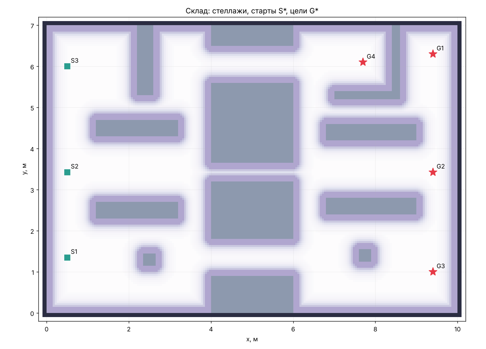

Склад 10 × 7 м. Через центральный блок стеллажей ведут три прохода: нижний (0.9 м),
**узкий коридор** (0.45 м, робот 0.21 м) и верхний (0.9 м). Стеллаж L3 закрывает выход
из зоны S3, U-образный тупик ловит прямую к G1, колонны C1 и C2 мешают ехать по прямой.
Старты S1–S3, цели G1–G4; любую пару можно задать через `--start/--goal`.

| Сценарий | Маршрут | Что происходит |
|---|---|---|
| `open` | S3 → G1 | Пустой склад: обход стеллажа и тупика, сравнение форм путей |
| `bypass` | S1 → G3 | В нижний проход падает коробка 0.4 м и прижимается к стеллажу. Рядом остаётся ~0.48 м: **можно объехать**, глобальный путь менять не нужно |
| `blocked` | S2 → G2 | Коробка падает в узкий коридор и перекрывает его целиком: **нужно перестроить маршрут** через верхний или нижний проход |
| `low_box` | S3 → G1 | В верхнем проходе лежит плоская коробка высотой 12 см. **Лидар её не видит** (его луч идёт на высоте 18 см), камера видит |

Коробки в `bypass` и `blocked` висят над проходом и падают (настоящая физика MuJoCo),
когда робот подъезжает ближе 1.6 м. Глобальный планировщик о них не знает, робот
замечает их датчиком.

## Как устроена навигация

```
 лидар (360°) или RGB-D камера (87°) ──> costmap: статический слой (карта) + слой препятствий
                                   │
 глобальный планировщик <──────────┤        навигатор (маленький аналог behavior tree Nav2)
 (A*, RRT-Connect, BIT*, AIT*)     │        ├─ цель достигнута?
          │ путь                   │        ├─ costmap изменился -> путь всё ещё свободен?
          v                        │        │    ├─ проход есть рядом и контроллер умеет объезжать -> ОБЪЕЗД
 локальный планировщик <───────────┘        │    └─ иначе -> ПЕРЕПЛАНИРОВАНИЕ
 (DWA, MPPI, ...) ──> (v, w) ──> колёса TurtleBot3 в MuJoCo
                                            └─ нет команды / нет прогресса -> восстановление
```

Решение «объезд или перепланирование» принимается так: берётся участок пути вокруг
препятствия плюс запас 0.6 м, и разметкой связных компонент свободного пространства
проверяется, соединены ли точки до и после препятствия. DWA и оба MPPI объезжают сами.
RPP, Graceful и Vector Pursuit только следуют пути, поэтому с ними навигатор перепланирует
в обоих сценариях (это видно в результатах).

Политику можно поменять: `--replan-policy always` (всегда перепланировать),
`never` (только при застревании), `--replan-period 1` (каждую секунду, как дерево Nav2 по умолчанию).

## Что получилось

`uv run mpp bench --sensors lidar,depth --seeds 2`: 4 глобальных × 6 локальных × 4 сценария ×
2 датчика × 2 повтора = 384 заезда. Доехали 360. Все 24 неудачи — `low_box` с лидаром,
который просто не видит коробку. Во всех остальных заездах нет ни одного касания стеллажей
или коробок.

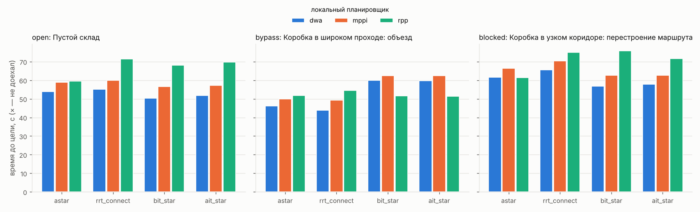

| | |
|---|---|
| 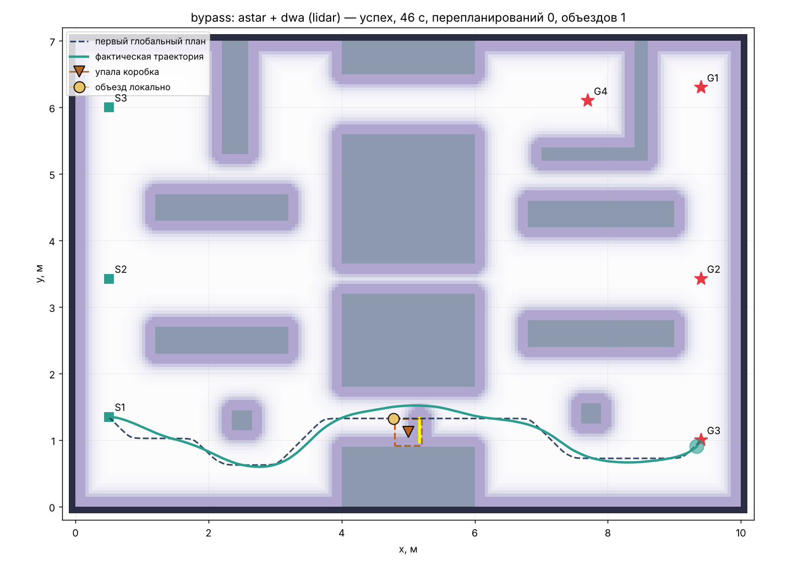 | 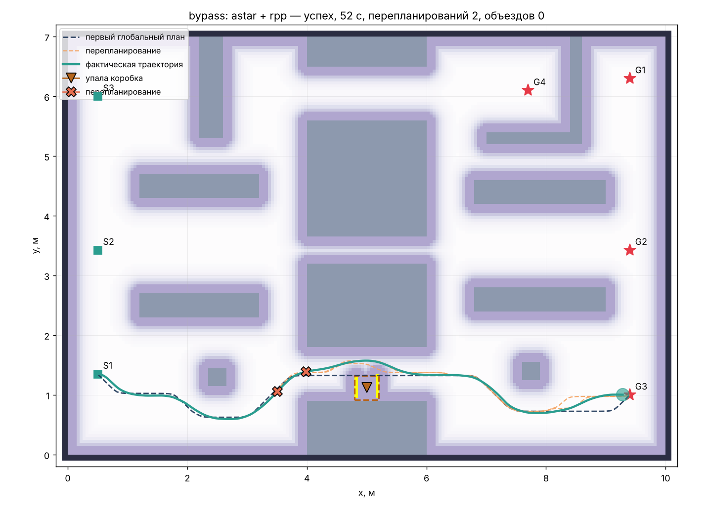 |
| `bypass`, A* + DWA: объезд силами локального планировщика, без перепланирования | `bypass`, A* + RPP: pure pursuit объезжать не умеет, навигатор перестраивает путь |
| 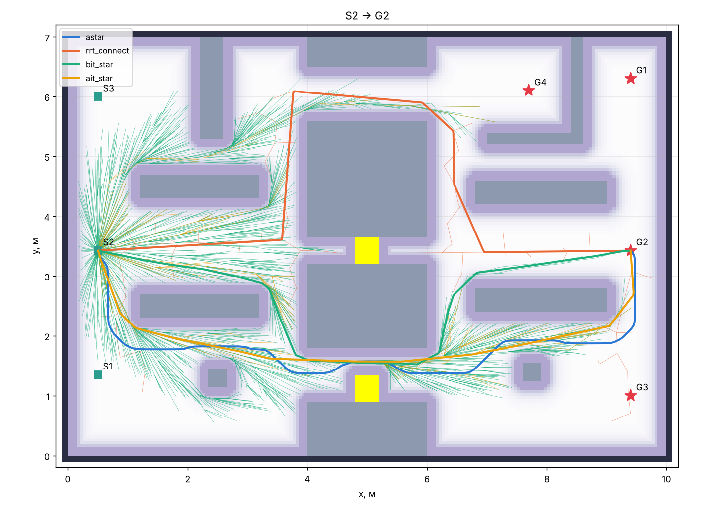 | 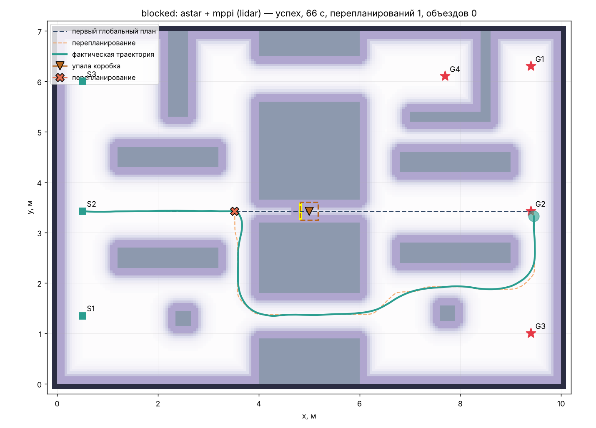 |
| Коридор закрыт: пути и деревья четырёх глобальных планировщиков | `blocked`, A* + MPPI: коробка замечена, маршрут перестроен через нижний проход |

Наблюдения:

* **A\*** даёт путь посередине проходов (штраф за близость к стеллажам), но он длиннее
  геометрически кратчайшего.
* **RRT-Connect** находит путь за миллисекунды, но «какой попало»: в `open` после
  сглаживания он может уйти в далёкий обход. Когда старт и цель на одной прямой (S2→G2),
  жадный шаг *connect* сразу пролетает узкий коридор.
* **BIT\*** и **AIT\*** за отведённую секунду почти сходятся к кратчайшему пути.
  AIT\* благодаря обратному поиску делает примерно в 10 раз меньше проверок столкновений.
  Кратчайший путь идёт ближе к стеллажам, поэтому коробка в `bypass` чаще ложится прямо
  на него, и локальному планировщику приходится сложнее.

## Насколько это правильно

Свои реализации легко написать с ошибкой, поэтому каждая сверена с эталоном.

**A\*** сравнивается с алгоритмом Дейкстры из `scipy.sparse.csgraph` на том же графе
(тест `tests/test_reference_astar.py`). Стоимость пути совпадает до 10⁻⁹ на всех парах
старт/цель.

**RRT-Connect, BIT\*, AIT\*** сравниваются с оригинальными C++-реализациями в
[OMPL](https://ompl.kavrakilab.org) на той же карте, с той же проверкой столкновений и тем
же бюджетом времени (`uv run python scripts/validate_global_planners.py`, полный отчёт в
[docs/validation.md](docs/validation.md)). AIT\* есть только в OMPL 1.7, поэтому скрипт
запускает её в отдельном окружении.

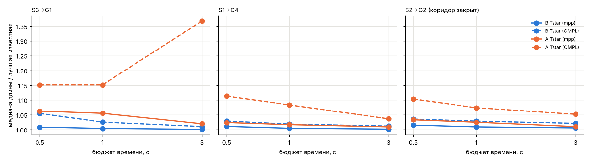

* Наши BIT\* и AIT\* приходят к тем же длинам путей, к которым OMPL сходится за 30 с
  (отклонение медианы 0.1–2 % при бюджете 3 с).
* RRT-Connect даёт такие же «случайные» пути, как OMPL (в 1.2–1.4 раза длиннее
  оптимального), — так и должно быть.
* На коротком бюджете OMPL AIT\* выглядит хуже нашего, но это из-за медленной проверки
  столкновений через Python-коллбэк: каждая точка ребра проверяется отдельным вызовом.
  С длинным бюджетом она сходится к тому же оптимуму.

**Локальные планировщики** нельзя запустить «из коробки» без ROS 2, поэтому они сверены с
исходным кодом Nav2 (октябрь 2026). Graceful Controller и Vector Pursuit перенесены по
исходникам; в RPP и MPPI после сверки исправлены расхождения (минимум из ограничений
скорости в RPP; ограничения ускорения в прокатках, член управления γ и сглаживание
Савицкого–Голея в MPPI). Подробности по каждому — в [docs/planners.md](docs/planners.md).

**Почему не взять готовую библиотеку целиком?** Для глобального планирования готовая есть —
OMPL. Она подключена как `-g ompl:BITstar`, `ompl:RRTConnect`, `ompl:RRTstar` и т. д., и
её можно использовать вместо наших. Для локального планирования стандарт — Nav2, но это
C++ и ROS 2: на macOS он не ставится, а в учебной песочнице за ним не видно самих
алгоритмов. Когда дойдёт до настоящего робота, логичный шаг — Nav2 на Ubuntu с теми же
алгоритмами: MPPI, RPP, Graceful там «родные».

## Локальные планировщики: что сейчас актуально

В Nav2 (октябрь 2026) стандартные контроллеры — DWB, **MPPI** (по умолчанию), Regulated
Pure Pursuit, **Graceful Controller** (самый новый) и Rotation Shim (поворот на месте перед
любым другим). В сообществе популярны **Vector Pursuit** и TEB. В исследованиях
активно развивают варианты MPPI: log-MPPI, MPPI с барьерными функциями (CBF), MPPI с
сэмплированием по карте.

В песочнице есть шесть контроллеров: три «классических» (DWA, MPPI, RPP) и три новых
(log-MPPI, Graceful, Vector Pursuit). Они делятся на два типа:

* **объезжают сами** (DWA, MPPI, log-MPPI): сэмплируют траектории и выбирают безопасную.
  Справляются с коробкой в широком проходе без перепланирования;
* **следуют пути** (RPP, Graceful, Vector Pursuit): точнее и плавнее держат путь, дешевле по
  вычислениям, но перед препятствием останавливаются и полагаются на глобальный планировщик.

Результаты с лидаром (доехали из запусков · среднее время до цели; все глобальные
планировщики вместе):

| локальный | open | bypass | blocked | перепланирований в `bypass` | объездов в `bypass` | мин. зазор до препятствия |
|---|---|---|---|---|---|---|
| DWA | 8/8 · 52 с | 8/8 · 53 с | 8/8 · 60 с | 0.5 | 1.4 | 1.5 см |
| MPPI | 8/8 · 58 с | 8/8 · 57 с | 8/8 · 64 с | 0.5 | 1.1 | 3.7 см |
| log-MPPI | 8/8 · 57 с | 8/8 · 57 с | 8/8 · 64 с | 0.5 | 1.5 | 2.3 см |
| RPP | 8/8 · 65 с | 8/8 · 53 с | 8/8 · 67 с | 1.6 | 0 | 4.7 см |
| Graceful | 8/8 · 70 с | 8/8 · 53 с | 8/8 · 79 с | 1.5 | 0 | 0.9 см |
| Vector Pursuit | 8/8 · 67 с | 8/8 · 56 с | 8/8 · 69 с | 1.9 | 0 | 4.5 см |

* **DWA** — самый быстрый, но и самый рискованный: проходит в 1.5 см от препятствий.
  Если коробка лежит ровно по центру пути, попадает в локальный минимум.
* **MPPI** плавный и аккуратный, считается примерно в 2 раза дольше DWA. **log-MPPI** на этой
  карте ведёт себя почти так же: его тяжёлые хвосты помогают в загромождённых местах и при
  малом числе образцов.
* **RPP** и **Vector Pursuit** точно держат путь. На ломаных путях сэмплирующих
  планировщиков они чаще останавливаются для поворота на месте, поэтому медленнее.
* **Graceful** едет плавными дугами, но с параметрами Nav2 по умолчанию сильно сбрасывает
  скорость на поворотах и в `blocked` самый медленный. Он же ближе всех подходил к
  препятствиям (0.9 см), так что запас `safety` в его проверке столкновений (1 см) стоит
  увеличить.

Вывод для дифференциального робота вроде TurtleBot3: MPPI — разумный выбор по умолчанию
(в Nav2 так и сделано). Graceful или RPP подойдут, если карта известна, а скорость и
плавность важнее объезда.

## Камера вместо лидара

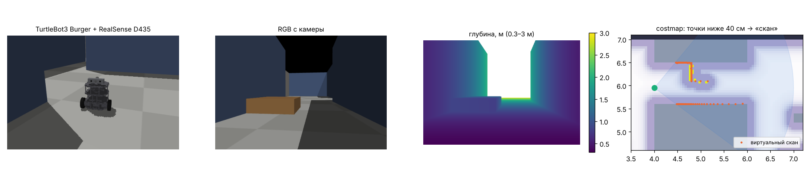

`--sensor depth` ставит на TurtleBot3 Burger камеру глубины **Intel RealSense D435** на место
лидара. Классический робот совсем без лидара — TurtleBot 2 (Kobuki + Orbbec Astra), но при
ширине 35 см он почти не помещается в наш коридор 45 см, поэтому взято шасси Burger с
камерой — тоже распространённая самодельная конфигурация.

Камера моделируется лучами через сетку пикселей: поле зрения 87° × 58°, глубина 0.3–3 м,
шум растёт как z² (около 2 см на 2 м, как в спецификации D435). Из облака точек убирается пол
и всё, что выше робота, а в каждом столбце изображения берётся ближайшая точка. Получается
«виртуальный лазерный скан», который идёт в costmap так же, как лидар. Так на реальных
роботах работают `depthimage_to_laserscan` и `pointcloud_to_laserscan`.

| | |
|---|---|
| 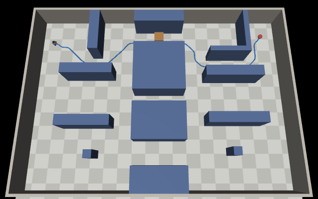 |  |
| `low_box`, лидар: коробка ниже луча, робот в неё упирается | `low_box`, камера: коробка видна, робот объезжает |

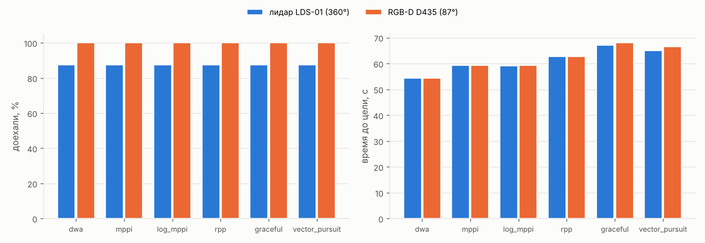

* В `open`, `bypass` и `blocked` камера справляется так же, как лидар: 144 из 144 заездов,
  время то же. Стеллажи есть на карте, а падающую коробку робот видит прямо перед собой.
* В `low_box` лидар не видит коробку ниже своего луча: 24 из 48 заездов, 1174 касания.
  Доехали только BIT\* и AIT\*, и им просто повезло: их кратчайший путь идёт по нижнему
  краю прохода, в стороне от коробки. Камера видит коробку: 48 из 48, ни одного касания.
* Слабые места камеры — узкое поле зрения (87°) и слепая зона ближе 0.3 м. Препятствие,
  появившееся сбоку или сзади, она не заметит, пока не повернётся к нему (упражнение в
  [docs/planners.md](docs/planners.md#упражнения)).

Про цену: дорогие — 3D-лидары. Простой 2D-лидар вроде LDS-02 или RPLIDAR C1 стоит
порядка $70–150, примерно как недорогая камера глубины (OAK-D Lite, Orbbec Astra ≈ $150;
RealSense D435 ≈ $300). Зато камера видит объём, а не одну плоскость, и даёт RGB-картинку
для распознавания.

## Исследование: локальное планирование для больших флотов

В [docs/research/fleet_local_planning.md](docs/research/fleet_local_planning.md) собран
обзор свежих работ (2024–2026) о SIMD-ускорении, обучаемых подсказках для MPPI,
масштабировании складских флотов и исполнении планов при плохой сети, плюс проверка идей
экспериментами:

* идея общей «памяти движения» флота **не подтвердилась**: тот же выигрыш даёт простая
  подсказка pure pursuit без памяти (`scripts/experiment_memory_miss.py`);
* предложены два узких направления на эталонном Nav2 MPPI: SIMD-ускорение проверки
  столкновений в `CostCritic` (измеренное узкое место) и обучаемая подсказка, которая
  снижает число траекторий.

## Структура

```
src/mpp/
  world/layout.py          карта склада: стеллажи, старты, цели
  world/scenarios.py       сценарии и коробки
  robot/                   MJCF TurtleBot3 Burger + меши ROBOTIS, параметры лидара и D435
  sim/                     сцена MuJoCo, колёса, лидар, RGB-D камера, падение коробок
  mapping/costmap.py       costmap: слои, инфляция, клиренс, интеграция скана
  planning/global_planners/ astar.py, rrt_connect.py, bit_star.py, ait_star.py, ompl_planner.py
  planning/local_planners/ dwa.py, mppi.py (+ log-MPPI), rpp.py, graceful.py, vector_pursuit.py
  navigation/navigator.py  связка планировщиков: объезд / перепланирование / восстановление
  runner.py                один эпизод + метрики
  bench.py                 матрица экспериментов, таблицы, графики
  viz/                     matplotlib-картинки, окно MuJoCo, запись GIF
scripts/                   проверка против OMPL, картинка с камеры
tests/                     юнит-тесты, сверка с эталонами, сквозные заезды
docs/planners.md           как работают алгоритмы, параметры и упражнения
docs/validation.md         отчёт о сверке с OMPL
```

## Упражнения

Идеи, с чего начать, собраны в [docs/planners.md](docs/planners.md#упражнения): от
настройки весов DWA и температуры MPPI до своего планировщика (Theta\*, Hybrid A\*,
TEB, MPC-CBF), камеры с узким полем зрения и нескольких роботов одновременно.

## Лицензии

Код проекта распространяется по MIT. Меши TurtleBot3 взяты из
[ROBOTIS-GIT/turtlebot3](https://github.com/ROBOTIS-GIT/turtlebot3) (Apache-2.0,
см. `src/mpp/robot/turtlebot3_burger/LICENSE`), модель переведена из URDF в MJCF вручную.
Graceful Controller и Vector Pursuit перенесены с C++ по исходникам
[Nav2](https://github.com/ros-navigation/navigation2) и
[vector_pursuit_controller](https://github.com/blackcoffeerobotics/vector_pursuit_controller)
(оба Apache-2.0). MuJoCo (Apache-2.0), OMPL (BSD-3).
